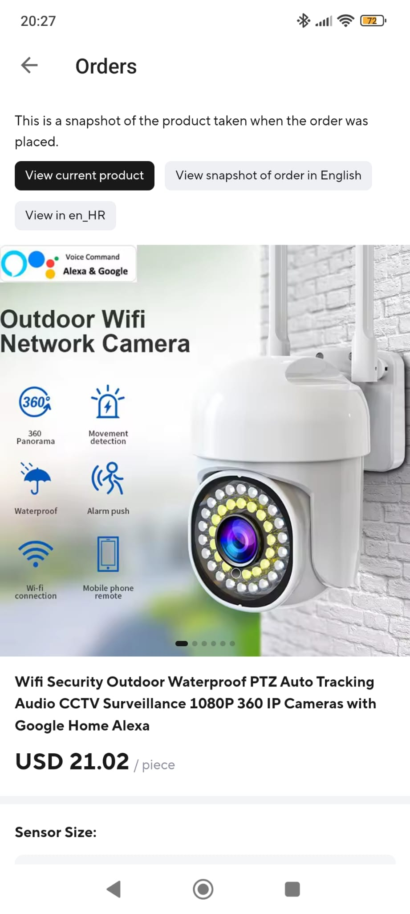
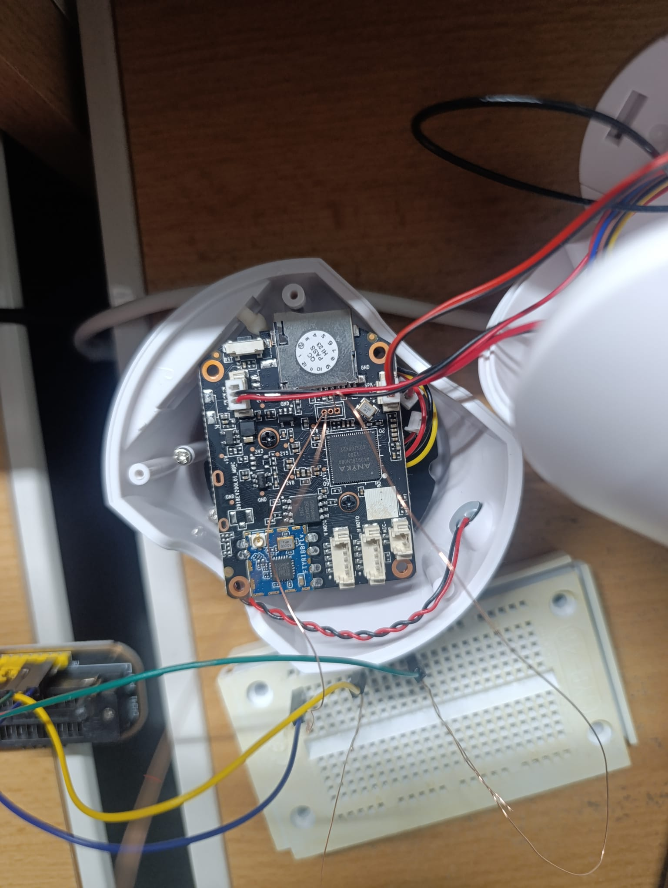
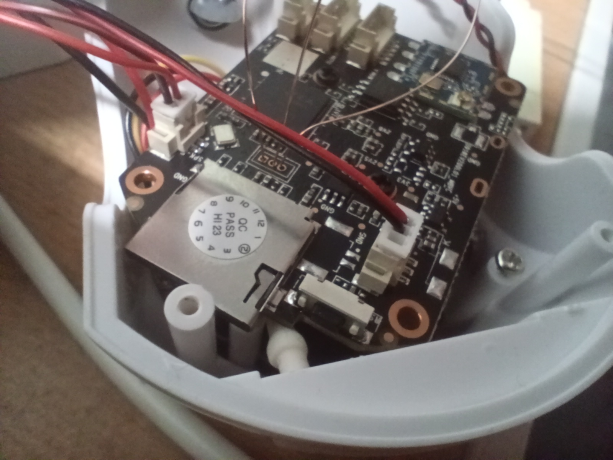
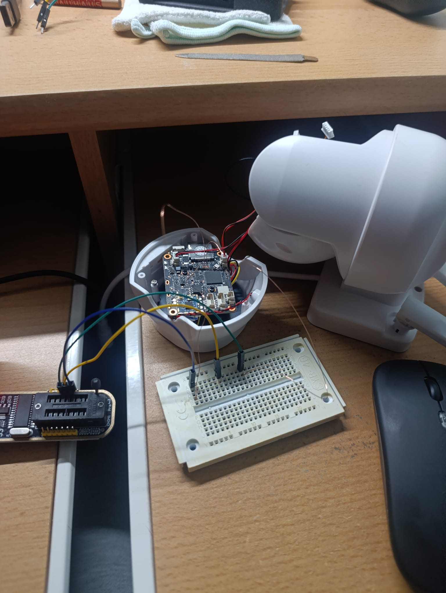

# Reverse engineer camera



A cheap Chinese Wi-Fi PTZ camera from AliExpress, brought back under my control. It runs without the cloud and without the vendor's app, and it does not send a single packet to the internet. Live video, the motors, night vision and the light all work in a browser on my home network, and recording to the SD card works as before.

## Why

The camera can only be set up through a phone app. After that it contacts the vendor's servers on its own: Yi P2P servers (`tnpmastercn.xiaoyi.com`), the Yi API and Alibaba Cloud, mostly in China. The live view in the app is set up through those servers too, even when the phone and the camera are in the same house.

I don't want that. The camera looks into my yard, so I want to own what I bought: to know exactly what it does, to keep everything local, and to remove its communication with the outside world entirely, not just hide it. We live in a time when we are increasingly the product, not the owners of what we buy.

The firmware itself stays unchanged. All changes start from the SD card, and with the card removed the camera is back to stock.

<br clear="right">

## How it was done

The commits in this repo follow these steps in order.

### 1. Taking the camera apart



**Why:** vendors of cameras like this usually leave a serial console on the board for factory testing. It is the easiest way into the system.

**What is on the board** (from the chip markings):
- an **Anyka AK3918EN080 V200** processor (ARM, Linux),
- an **RTL8188FTV** Wi-Fi module,
- 8 MB of SPI flash,
- a microSD slot,
- connectors for the two motors (`H MOTO`, `V MOTO`), the microphone and the speaker,
- next to the processor, **three pads in a row** with no connector, one of them square.

Three pads next to the processor, with a square pin 1, are the typical layout of a serial console (GND, TX, RX).

### 2. Connecting to the UART

 

Thin copper wires connect the UART pads, through a breadboard, to a **CH341A** programmer that works as a USB serial adapter.

| Camera pad | Adapter |
|---|---|
| left | GND |
| middle (camera TX) | RX |
| right, square (camera RX) | TX |

**How this was worked out:**
- TX and RX measure 3.3 V, so the adapter runs at 3.3 V. Its 3.3V pin is left unconnected, because the camera has its own power supply.
- 115200 8N1 is the usual speed for Anyka chips, and it gave a readable boot log right away.
- TX and RX were found by trying. With the wires swapped, the console does not work in both directions.

### 3. The console

The console gives a root shell with no password (`[root@anyka ~]$`). The boot log shows U-Boot 2013.10 and Linux 3.4.35.

The problem was constant log spam. `anyka_ipc`, the camera's main program, and the Wi-Fi scripts keep searching for the saved network and restart the radio every two minutes. That process cannot simply be stopped: `daemon` holds a hardware watchdog (8 s) and resets the camera. So `serial.ps1` filters the spam on the computer side.

The boot log contains the Wi-Fi password and the Yi bindkey in plain text, so no logs are in this repo.

Wiring details and commands are in [KAMERA.md](KAMERA.md) (in Croatian).

### 4. Copying the firmware to an SD card

**Why:** to analyse the firmware on a computer, and to have a backup before changing anything.

**How:** on the camera, all seven flash partitions (`/dev/mtdblock0`–`6`) are copied to the card, with an `md5sum` computed by the camera itself. On the computer the copy is verified and unpacked (`unsquashfs`) into a tree laid out as on the camera.

| Partition | Contents |
|---|---|
| A | rootfs `/`, squashfs, read-only |
| B | `/usr`, squashfs, applications and libraries |
| C | `/etc/jffs2`, jffs2, settings (the only writable part) |

This shows an important limit: the programs live on squashfs, which is read-only, so they cannot simply be overwritten.

### 5. Decompiling

The programs in `/usr/bin` (27 of them) and the Yi libraries were decompiled to C with **Ghidra 12.1**. The call flow in `anyka_ipc` was also traced with [REA](https://github.com/morluto/rea) and Hopper. `anyka_ipc` has debug information, so function names and messages are readable.

**What turned up:**
- Everything that goes out passes through `anyka_ipc`, three Yi libraries (`libYiP2P.so`, `liboss.so`, `libcloudapi.so`) and the `cloudAPI` program. All of them are started by a single function, `ak_yi_init` (`yi_cloud_init`, `yi_oss_init`, `start_p2p`).
- The camera has **no** RTSP or ONVIF server. Settings for them exist, but nothing uses them. Live video only exists through the cloud, so local streaming had to be written.
- `anyka_ipc` and `libYiP2P.so` call each other. The program calls `yi_p2p_*`, and the library calls back through `yi_p2p_on_*`, for example `yi_p2p_on_new_session` when a viewer connects. That is why a replacement library can pretend to be the Yi app and get H.264 frames from `anyka_ipc`.
- An FTP server runs on port 21 with access to the whole system and no password.

The decompiled parts that get replaced are in [original/](original/).

### 6. Debug mode from the SD card

The startup script `/usr/sbin/service.sh` contains this hook:

```sh
if test -d /mnt/debug ;then
	DEBUG_MODE=1
...
if [ $DEBUG_MODE = 1 ]; then
	echo "#################debug mode##############"
	/mnt/debug/config.sh
fi
```

If the card has a `debug` folder, the camera runs `/mnt/debug/config.sh` as root at boot, before `daemon` and `anyka_ipc` start.

**Why this route:**
- The flash stays untouched, so there is no risk of bricking the camera.
- Everything is reversible: without the card the camera is stock.
- The script gets to put the replacements in place before the originals even start.

### 7. My own parts on the card

`config.sh` copies everything to RAM and uses `mount -o bind` to lay the replacements over the originals. The flash is never touched, and everything is gone when the camera powers off.

| Original ([original/](original/)) | Replacement ([localcam/](localcam/)) | What it does now |
|---|---|---|
| `usr/lib/libYiP2P.so` | `src/libyip2p_local.c` | a web server on port 80 instead of a P2P link to the Yi servers |
| `usr/lib/liboss.so`, `usr/lib/libcloudapi.so` | `src/cloud_stubs.c` | every cloud function returns an error and sends nothing |
| `usr/bin/cloudAPI` | `sd/debug/cloudAPI` | every call gets the answer "failed" |
| Wi-Fi and update scripts in `usr/sbin/` | `sd/debug/scripts/noop.sh`, `net_start.sh` | `anyka_ipc` leaves Wi-Fi and updates alone; `net_start.sh` brings up the network |
| `usr/sbin/anyka_ipc.sh` | `sd/debug/scripts/anyka_ipc.sh` | starts `anyka_ipc` the same way, without console output and without remounting the card |

**How the `libYiP2P.so` replacement was worked out:**
- `anyka_ipc` uses 25 of its functions and exports the `yi_p2p_on_*` functions it calls.
- The decompiled threads in `anyka_ipc` show the order of the calls.
- The replacement exports the same functions, but opens an HTTP server instead of a P2P link. When a browser opens `/stream`, it calls `yi_p2p_on_new_session` as if the Yi app had connected. `anyka_ipc` then sends H.264 frames through `yi_p2p_send_frame_data` by itself.

**How it is built and tested:**
- The camera has an ARM processor and the computer is x86, so the code is built with a compiler for ARM (a cross-compiler).
- It is built against the camera's **uClibc**, a small version of the standard C library used on embedded devices. Otherwise the camera would not even load the library.
- The tools live in a **Docker** container, so nothing is installed on the computer and the build is the same every time.
- Testing happens on the computer, without the camera. **qemu**, an ARM processor emulator, runs the real replacement library, and a small fake program stands in for `anyka_ipc` and sends made-up frames.

**Problems along the way:**
- The camera's busybox has no `tr`, so the scripts had to do without it.
- When recording starts, `anyka_ipc` runs `fuser -m -k /mnt`, which kills everything with a file open on the card, including itself. So everything runs from RAM.
- `anyka_ipc` unmounted the exFAT card. Now `sdguard.sh` intercepts those calls.
- The picture lagged 10–20 s behind. Now the send buffer is small, and when Wi-Fi falls behind, frames are dropped until the next key frame.
- Wi-Fi power saving is off, because it added delay and lost packets.

### 8. The result

The camera's page in the browser has:
- live video in HD (1280×720) or SD (640×360),
- arrows for the motors,
- night vision (automatic, on or off) and a white light,
- image flip and mirror, which also apply to recordings,
- `/status` with the network state.

The camera still records to the SD card. How to use it: [localcam/README.md](localcam/README.md) (in Croatian).

## Why the camera cannot get out

- Everything that calls the Yi cloud is replaced (table above), so no connection even starts.
- On home Wi-Fi the camera takes only an address from the router. It ignores the gateway and DNS (`scripts/udhcpc.sh`), `/etc/resolv.conf` is empty, and `scripts/watch.sh` deletes the default route if anything adds one.
- When the camera runs its own network, that network has no gateway or DNS.
- **http://ADDRESS/status** shows the routes and DNS, so all of this can be checked.

For extra safety, the camera's internet access can also be blocked on the router.

## What is where

| Folder | Contents |
|---|---|
| [KAMERA.md](KAMERA.md), `serial.ps1` | serial console and copying the flash |
| [original/](original/) | stock firmware: the decompiled parts that talk to the cloud and the scripts that get replaced |
| [localcam/](localcam/) | the replacement, with usage instructions |

Not in the repo: the flash dump, the unpacked rootfs, the rest of the decompiled firmware, logs and `wifi.conf` with its passwords.
